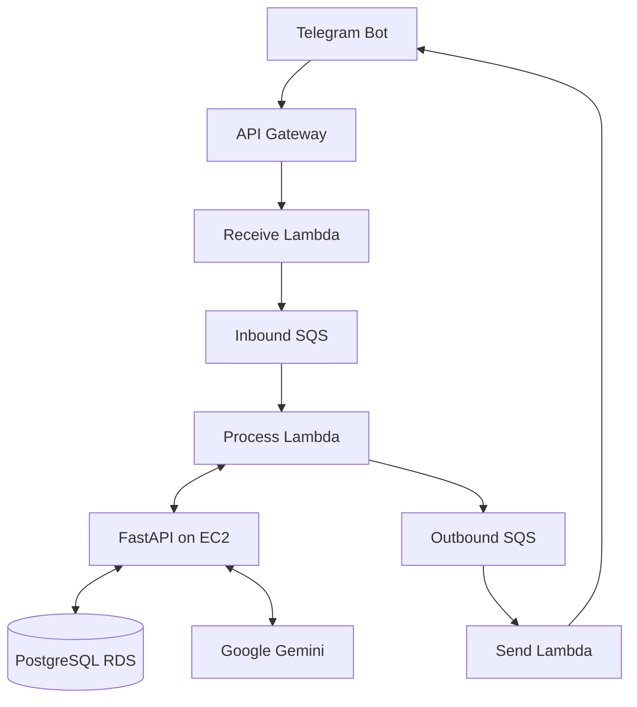
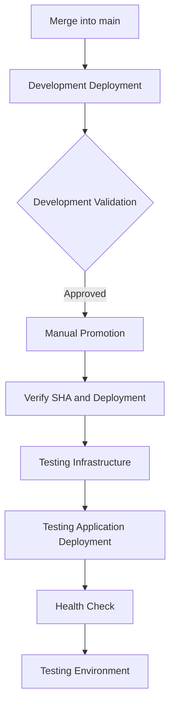

# NASC

NASC is an AI-powered support assistant for parents and caregivers of autistic children.

## Technology Stack

- Python and FastAPI
- PostgreSQL and SQLAlchemy
- Pydantic AI and Google Gemini
- Telegram Bot API
- AWS and Terraform
- Docker and GitHub Actions

## Telegram Integration

The Telegram integration supports:

- Private conversations with the bot.
- Account linking and user authorization.
- Incoming text and voice messages.
- Audio transcription using Google Gemini.
- Conversation history and context preservation.
- Text responses regardless of the incoming message type.

### Voice Message Limits

| Parameter                       | Default     |
| ------------------------------- | ----------- |
| Audio format                    | OGG/Opus    |
| Maximum file size               | 5 MiB       |
| Maximum duration                | 300 seconds |
| Download timeout                | 30 seconds  |
| Transcription timeout per model | 60 seconds  |
| Total transcription timeout     | 180 seconds |
| Chat timeout per model          | 60 seconds  |
| Total chat timeout              | 180 seconds |

Audio attachments, documents, and videos are not supported.

Audio files are processed in memory without permanent audio storage. Transcriptions are stored as text in the conversation history.

## AI Configuration

Chat and transcription use independent, ordered lists of Gemini models:

- `GEMINI_CHAT_MODELS`
- `GEMINI_TRANSCRIPTION_MODELS`

The first model is the primary model. Subsequent models are fallback options.

See `backend/.env.example` for available environment variables and default processing limits.

## Infrastructure

AWS infrastructure is managed through Terraform using reusable modules and independent environment configurations.

### Directory Structure

```text
infra/
├── bootstrap/
├── modules/
│   └── common/
├── dev/
├── test/
└── prod/

deploy/
└── common/
```

- `bootstrap`: shared infrastructure, Terraform state storage, ECR repository, IAM provisioning roles, OIDC integration, and permissions boundaries.
- `modules/common`: reusable application infrastructure.
- `dev`: development environment configuration.
- `test`: testing environment configuration.
- `prod`: production environment configuration, not yet provisioned.
- `deploy/common`: reusable deployment scripts and Docker Compose configuration.

### Environments

| Environment | Purpose                            | VPC CIDR      | Status          |
| ----------- | ---------------------------------- | ------------- | --------------- |
| `dev`       | Development and initial validation | `10.0.0.0/16` | Active          |
| `test`      | Functional testing and acceptance  | `10.1.0.0/16` | Active          |
| `prod`      | Production                         | `10.2.0.0/16` | Not provisioned |

Each provisioned environment has its own:

- VPC, subnets, route tables, and security groups.
- EC2 instance running the FastAPI application.
- RDS PostgreSQL database.
- Lambda functions for receiving, processing, and sending Telegram messages.
- SQS FIFO queues and dead-letter queues.
- API Gateway and Telegram webhook.
- Telegram bot and account associations.
- Secrets Manager secret.
- IAM execution and provisioning roles.
- Terraform state and state lock.

The ECR repository, Terraform state bucket, and administrative infrastructure are shared.

### Application Architecture



This architecture is independently provisioned for each active environment.

### Terraform State

Terraform state is stored in a shared S3 bucket with versioning and state locking enabled.

Each environment uses an independent state key:

| Configuration | State key                     |
| ------------- | ----------------------------- |
| Bootstrap     | `bootstrap/terraform.tfstate` |
| Development   | `dev/terraform.tfstate`       |
| Testing       | `test/terraform.tfstate`      |
| Production    | `prod/terraform.tfstate`      |

Environment-specific IAM policies restrict access to the corresponding application state and lock files.

## Deployment

Application and infrastructure deployments are managed through GitHub Actions.

### Workflows

| Workflow        | Purpose                                       |
| --------------- | --------------------------------------------- |
| `dev.yml`       | Automated development deployment              |
| `test.yml`      | Manual promotion from development to testing  |
| `terraform.yml` | Reusable infrastructure provisioning workflow |
| `deploy.yml`    | Reusable application deployment workflow      |

### Development Deployment

Relevant changes merged into the `main` branch automatically trigger the Development workflow.

The workflow:

1. Detects infrastructure and application changes.
2. Builds Lambda deployment packages when infrastructure provisioning is required.
3. Plans and applies Terraform changes when required.
4. Builds or reuses the backend Docker image associated with the commit SHA.
5. Stores new backend images in the shared ECR repository.
6. Deploys the application to the development EC2 instance.
7. Executes database migrations.
8. Verifies application health.

### Promotion to Testing

Testing deployments are manually triggered using a commit SHA that has already been successfully deployed to development.



To promote a version:

1. Open the repository's GitHub Actions page.
2. Select the **Development** workflow.
3. Identify the full commit SHA of a successfully deployed and functionally validated version.
4. Select the **Testing** workflow.
5. Click **Run workflow**.
6. Select the `main` branch.
7. Enter the commit SHA in the `source_sha` field.
8. Run the workflow and monitor its execution.

The Testing workflow verifies that the selected commit has a successful development deployment before provisioning infrastructure or deploying the application.

The backend Docker image is reused from ECR without rebuilding it. Lambda packages are rebuilt from the selected commit SHA.

The shared ECR repository uses immutable image tags to prevent existing tags from being overwritten.

Functional approval is performed manually before promotion. The automated validation verifies deployment success.

### Rollback

A previously deployed development version can be promoted again to testing using its original commit SHA, provided that:

- Its backend image remains available in ECR.
- The commit contains a compatible testing infrastructure configuration.
- Its infrastructure and application versions remain compatible with the current environment.
- Its application version is compatible with the current database schema.

Database migrations are not automatically reversed during rollback.

Infrastructure changes must be reviewed before promoting an older version because Terraform may modify, replace, or remove resources.

Database backups and explicit migration rollback procedures may be required.

## Environment Configuration

### GitHub Environments

Each active environment has its own GitHub Environment and environment-specific variables.

| Variable                      | Purpose                                    |
| ----------------------------- | ------------------------------------------ |
| `AWS_ROLE_ARN`                | Environment-specific AWS provisioning role |
| `AWS_REGION`                  | AWS deployment region                      |
| `GEMINI_CHAT_MODELS`          | Ordered list of chat models                |
| `GEMINI_TRANSCRIPTION_MODELS` | Ordered list of transcription models       |

GitHub Actions authenticates with AWS through OIDC, without requiring permanent AWS access keys in GitHub Secrets.

### AWS Secrets Manager

Sensitive application configuration is stored independently for each environment.

| Environment | Secret name               |
| ----------- | ------------------------- |
| Development | `nasc/dev/app`            |
| Testing     | `nasc/test/app`           |
| Production  | `nasc/prod/app` (planned) |

Each active environment requires the following secret keys:

| Key                                 | Purpose                             |
| ----------------------------------- | ----------------------------------- |
| `DB_PASSWORD`                       | PostgreSQL password                 |
| `JWT_SECRET_KEY`                    | JWT signing key                     |
| `TELEGRAM_BOT_TOKEN`                | Telegram bot authentication         |
| `TELEGRAM_BOT_USERNAME`             | Telegram bot username               |
| `TELEGRAM_WEBHOOK_SECRET`           | Telegram webhook authentication     |
| `GEMINI_API_KEY`                    | Google Gemini authentication        |
| `CHANNEL_API_KEY`                   | Internal channel API authentication |
| `CHANNEL_LINK_TOKEN_EXPIRE_MINUTES` | Account linking token expiration    |

Authentication credentials and Telegram bot tokens must not be shared between environments.

### Telegram Configuration

Each environment requires a dedicated Telegram bot.

After provisioning an environment:

1. Create a bot using BotFather.
2. Configure the bot token, username, and webhook secret in AWS Secrets Manager.
3. Retrieve the environment's `telegram_webhook_url` Terraform output.
4. Register the webhook through the Telegram Bot API using the corresponding webhook secret.
5. Create the initial application administrator.
6. Link authorized application users to their Telegram accounts.

The same Telegram account may be independently linked to different environment-specific bots without sharing conversation history or account associations.

### Initial Administrator

Connect to the corresponding EC2 instance through AWS Systems Manager and execute:

```bash
sudo docker exec -it nasc-backend python -m scripts.bootstrap_admin
```

The script prompts for the administrator's email and password.

Administrators and application users are stored independently in each environment's database.

### Remote API Access

The FastAPI application can be accessed through AWS Systems Manager port forwarding without exposing its application port directly to the public internet.

Development:

```bash
aws ssm start-session \
  --target DEV_INSTANCE_ID \
  --document-name AWS-StartPortForwardingSession \
  --parameters portNumber=8000,localPortNumber=8001 \
  --region us-east-2
```

Testing:

```bash
aws ssm start-session \
  --target TEST_INSTANCE_ID \
  --document-name AWS-StartPortForwardingSession \
  --parameters portNumber=8000,localPortNumber=8002 \
  --region us-east-2
```

Replace the instance ID placeholders with the corresponding Terraform `ec2_instance_id` outputs and use an authorized AWS identity.

| Environment | Swagger UI                 |
| ----------- | -------------------------- |
| Development | http://localhost:8001/docs |
| Testing     | http://localhost:8002/docs |

Local port numbers may be adjusted as needed.

## Security and Environment Isolation

The current MVP uses a single AWS account with environment isolation implemented through:

- Independent VPCs and security groups.
- Independent databases and application resources.
- Environment-specific resource names and tags.
- Independent Terraform states.
- Environment-specific IAM provisioning and execution roles.
- IAM permissions boundaries.
- Independent application credentials and Telegram bots.
- GitHub Environment deployment restrictions.

Application data, account associations, conversation history, and message processing queues are isolated between environments.

IAM isolation is partial because some AWS operations require broader permissions and administrative resources are shared.

Remote access credentials should follow the principle of least privilege. Administrative Terraform credentials must not be used for routine application access.

Separate AWS accounts are recommended before introducing a production environment that handles sensitive user data.

## Infrastructure Costs

Each active environment provisions independent application resources and therefore contributes to the overall AWS infrastructure cost.

The main cost categories include:

- EC2 instances and EBS volumes.
- RDS instances and database storage.
- Lambda invocations.
- API Gateway requests.
- SQS requests.
- Secrets Manager secrets.
- CloudWatch logs.
- ECR image storage.
- S3 Terraform state storage.
- Public IPv4 addresses and network data transfer.

Actual costs depend on resource configuration, usage, region, and available AWS credits.

Google Gemini usage is billed separately according to the applicable Google pricing and quotas.

An aggregate cost assessment should be completed before provisioning production.

## Current Status

- [x] Reusable Terraform infrastructure module.
- [x] Independent development and testing environments.
- [x] Automated development deployments.
- [x] Controlled promotion from development to testing.
- [x] Shared immutable backend image repository.
- [x] Independent Telegram integrations.
- [x] Development and testing functional validation.
- [x] Production infrastructure configuration.
- [ ] Dedicated least-privilege credentials for routine remote access.
- [ ] Production security and infrastructure configuration review.
- [ ] Production provisioning.
